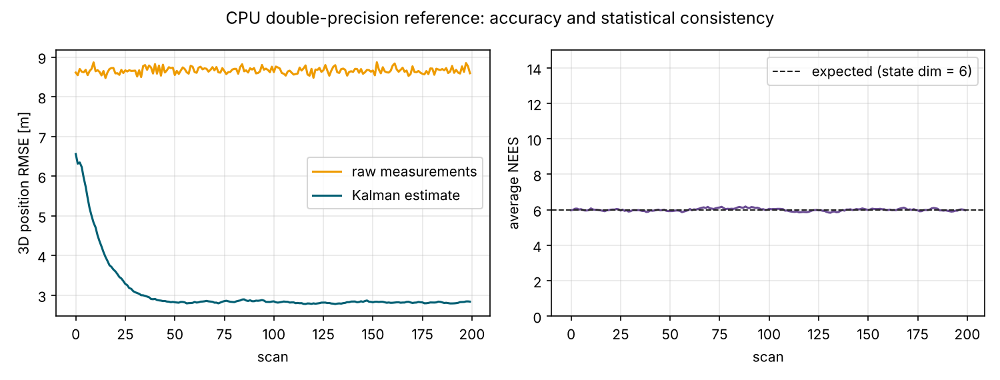
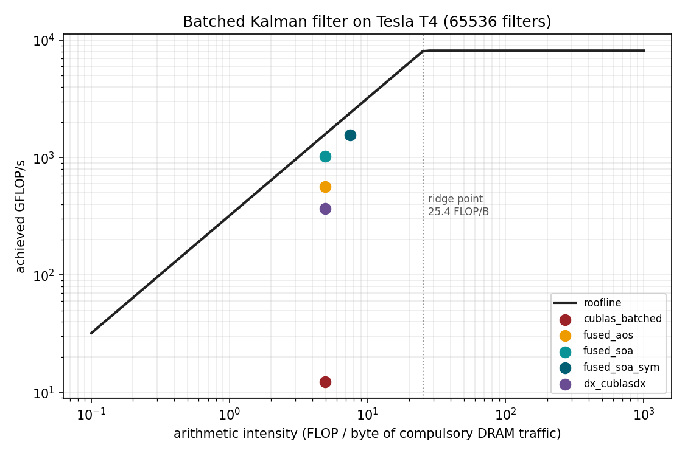
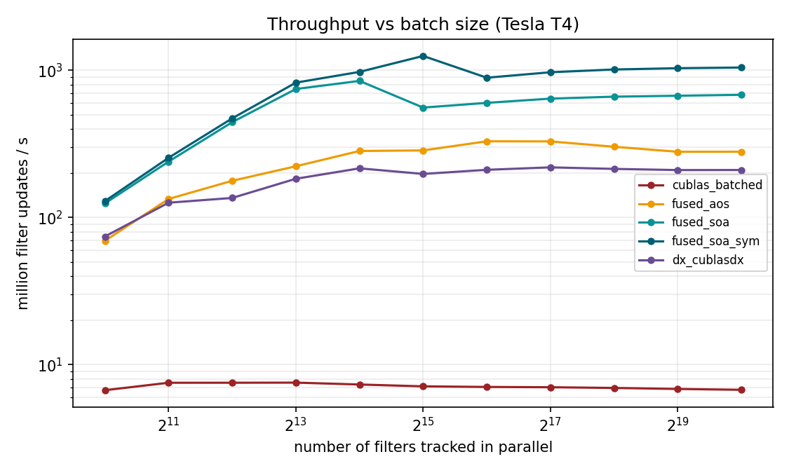

# Batched Kalman filtering on GPU: from cuBLAS to fused kernels with cuBLASDx

Tracking **tens of thousands of targets at once** (radar, multi-object tracking, sensor
fusion) means running thousands of *tiny* Kalman filters in parallel: 6×6 covariances,
3×3 innovation matrices. This is the worst case for classic BLAS libraries and exactly the
use case of NVIDIA's device-side math libraries (**cuBLASDx / cuSolverDx**).

This project implements the same filter five ways, checks every one of them against a
double-precision CPU reference, and explains the performance with a roofline model.

| Variant | Kernels / step | Idea |
|---|---|---|
| `cublas_batched` | 9 | Host-side `cublasSgemmStridedBatched` + `cublasSmatinvBatched`. Every intermediate goes through DRAM. |
| `fused_aos` | 1 | One thread = one filter, whole step on registers. Array-of-structs layout (uncoalesced). |
| `fused_soa` | 1 | Same kernel, struct-of-arrays layout: every warp load is one 128-byte transaction. |
| `fused_soa_sym` | 1 | SoA + only the upper triangle of P (21 floats instead of 36). |
| `dx_cublasdx` | 1 | One block = 32 filters in shared memory, GEMMs done by **cuBLASDx** inside the kernel ("shared-model batching", below). Optional **cuSolverDx** `posv` for the 3×3 solves. |

---

## 1. The filter

3D constant-velocity target, state $x = [p_x, p_y, p_z, v_x, v_y, v_z]^T$ ($n = 6$),
position measurements ($m = 3$), white-acceleration process noise:

$$
F = \begin{bmatrix} I_3 & \Delta t\, I_3 \\ 0 & I_3 \end{bmatrix},\qquad
Q = q \begin{bmatrix} \tfrac{\Delta t^3}{3} I_3 & \tfrac{\Delta t^2}{2} I_3 \\ \tfrac{\Delta t^2}{2} I_3 & \Delta t\, I_3 \end{bmatrix},\qquad
H = \begin{bmatrix} I_3 & 0 \end{bmatrix},\qquad R = \sigma^2 I_3
$$

Every variant implements exactly this algebra:

$$
\begin{aligned}
&\text{predict:} && x \leftarrow F x, \qquad P \leftarrow F P F^T + Q \\
&\text{update:}  && S = H P H^T + R = L L^T \quad\text{(Cholesky)} \\
&                && K^T = S^{-1} (H P) \quad\text{(two triangular solves, 6 right-hand sides — no inverse)} \\
&                && x \leftarrow x + K (z - H x), \qquad P \leftarrow P - K (H P)
\end{aligned}
$$

($K^T = S^{-1} H P$ holds because $P$ is symmetric, so $K = P H^T S^{-1} = (S^{-1} H P)^T$.)

## 2. Shared-model batching (the `dx_cublasdx` kernel)

$F$ and $H$ are the same for every target. A block holding $B = 32$ filters stores their
covariances side by side in shared memory, so the 32 small products become **one** GEMM:

$$
F \,\big[\,P_1 \mid P_2 \mid \dots \mid P_{32}\,\big] = \big[\,F P_1 \mid \dots \mid F P_{32}\,\big]
\qquad (6\times6)\cdot(6\times192)
$$

For $F P F^T$, symmetry gives $(F P_i)^T = P_i F^T$: after transposing each 6×6 block in
shared memory, the **same** GEMM yields $F (P_i F^T) = F P_i F^T$. Likewise
$H [P_1 \mid \dots \mid P_{32}]$ is one (3×6)·(6×192) GEMM. The 32 systems
$S_i K_i^T = H P_i$ are then solved in one batched call (cuSolverDx `posv` with
`BatchesPerBlock<32>`) or by a register Cholesky, one thread per filter.

Per step and per filter, global memory sees one read of $(x, P, z)$ and one write of
$(x, P)$: nothing else leaves the chip.

## 3. Performance model

Per filter and per step (counted in `kf_common.hpp`):

| | value |
|---|---|
| floating-point operations | **1 716 FLOP** |
| compulsory DRAM traffic, full P | 348 bytes → intensity **4.9 FLOP/byte** |
| compulsory DRAM traffic, symmetric P | 228 bytes → intensity **7.5 FLOP/byte** |

The ridge point of a T4 is 8.1 TFLOP/s ÷ 320 GB/s ≈ **25 FLOP/byte** (≈ 12 on an A100,
≈ 100 on an L4). The problem is therefore **memory-bound** on every current GPU: the
FLOPs are almost free, and the goal is to move as few bytes as possible at peak bandwidth.
That gives a hard upper bound on a T4 of ≈ 920 million filter updates/s with a full P,
≈ 1 400 million with a symmetric P. This is why the optimisations here are about **data
movement** (fusion, coalescing, symmetry), not about arithmetic.

## 4. Correctness

`tests/test_cpu.cpp` (2 000 targets, 200 scans, double precision):

* 3D position RMSE: **8.66 m** for raw measurements → **2.82 m** for the filter;
* average NEES $(x-x_{true})^T P^{-1} (x-x_{true})$ = **5.98**, expected 6: the covariance
  the filter reports is statistically honest;
* float vs double after 200 scans: max state error **1.7·10⁻³ σ**.



`tests/test_layout_logic.cpp` replays the index arithmetic of the Dx kernel (block
transposes, tail block, padding) and of the cuBLAS sequence on the CPU.
`kf_bench` compares every GPU variant with the CPU reference at the end of the run
(state error in units of σ, covariance error normalised by $\sqrt{P_{ii}P_{jj}}$) and prints
`MISMATCH` if a variant goes off.

## 5. Results

> Run `notebooks/run_on_colab.ipynb` (free T4) and paste the table printed by `kf_bench`.

| GPU | variant | µs / step (65 536 filters) | M updates / s | GB/s | % of peak BW |
|---|---|---|---|---|---|
| T4 | cublas_batched | | | | |
| T4 | fused_aos | | | | |
| T4 | fused_soa | | | | |
| T4 | fused_soa_sym | | | | |
| T4 | dx_cublasdx | | | | |




## 6. Build and run

**Colab (no local GPU needed):** open `notebooks/run_on_colab.ipynb`, select a T4 runtime,
run all cells.

**Local (CUDA 12.x or 13.x, CMake ≥ 3.24):**

```bash
pip install nvidia-mathdx==25.6.0          # cuBLASDx headers (auto-detected by CMake)
cmake -S . -B build -DKF_ARCH=75           # 75=T4, 80=A100, 86=RTX30xx, 89=L4/RTX40xx, 90=H100
cmake --build build -j
cd build && ctest --output-on-failure && cd ..
./build/kf_bench --filters 65536 --steps 100 --csv results/bench.csv
./build/kf_bench --sweep --csv results/sweep.csv
python scripts/plot_results.py --bench results/bench.csv --sweep results/sweep.csv \
                               --cpu results/cpu_rmse.csv --out results
```

**With cuSolverDx:** download the full MathDx package (it contains the
`libcusolverdx` LTO library), then

```bash
cmake -S . -B build -DKF_ARCH=75 -DKF_WITH_CUSOLVERDX=ON \
      -DMATHDX_INCLUDE=<mathdx>/include -DCUTLASS_INCLUDE=<mathdx>/external/cutlass/include \
      -DMATHDX_LIB_DIR=<mathdx>/lib
```

## 7. Code map

```
include/kf_common.hpp      model, synthetic radar scenario, CPU reference, cost model
src/kf_device.cuh          model in __constant__ memory, register Cholesky, fused step
src/kf_fused.cuh           thread-per-filter kernels (AoS / SoA / SoA-symmetric)
src/kf_cublas.cuh          9-launch cuBLAS baseline
src/kf_dx.cuh              block-per-32-filters kernel: cuBLASDx GEMMs (+ cuSolverDx)
src/main.cu                benchmark driver, layout conversion, GPU-vs-CPU checks, CSV
tests/                     CPU reference tests, index-logic emulation of the GPU kernels
scripts/plot_results.py    roofline, throughput sweep, tracking accuracy
```

## 8. Open questions / next steps

* **Register pressure:** the thread-per-filter kernels use 168–187 registers per thread
  (`-Xptxas -v`), which caps occupancy. Does `__launch_bounds__(128, 4)` or splitting the
  step across a few threads hide DRAM latency better?
* **Where does Dx win?** With $n = 6$ the GEMMs are tiny and the register kernel is hard to
  beat. Sweeping $n$ (constant-acceleration models, $n = 9$; IMU fusion, $n = 15$+) should
  show the crossover where cuBLASDx's shared-memory GEMMs overtake per-thread math.
* **Launch overhead:** capture the cuBLAS sequence in a CUDA Graph to separate launch cost
  from DRAM round trips.
* **Numerics:** Joseph-form or square-root (Cholesky-factor) filters for long float runs.
